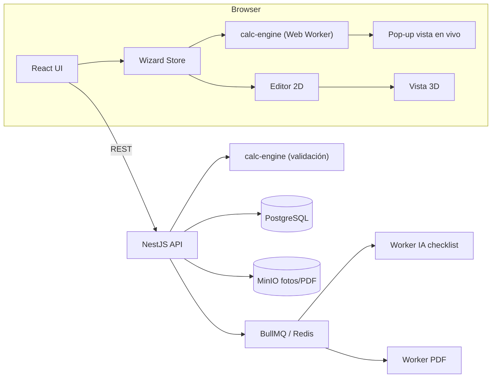

# 01 · Arquitectura

## 1. Decisión de plataforma

| Opción | Veredicto | Motivo |
|---|---|---|
| HTML + JS puro | ❌ | No escala a 17 módulos, 2D/3D y RBAC |
| Python (Django/FastAPI) + JS | ⚠️ | Dos lenguajes → el motor de cálculo se duplicaría (front para vista en vivo, back para validar) |
| **TypeScript full-stack (Node.js)** | ✅ **Elegido** | Un solo lenguaje; el **mismo motor de cálculo** corre en el navegador (pop-up en vivo) y en el servidor (validación al guardar). Tipado fuerte = módulos seguros y refactorizables |

### Base de datos: **PostgreSQL 16** (sobre MySQL)
- `JSONB` indexable → snapshots de versiones y datos de cada paso sin migraciones constantes.
- Triggers y `CHECK` robustos → inmutabilidad del Paso 0.
- CTE recursivas, `ltree`/arrays → árbol de versiones y dependencias.
- Row Level Security disponible para multi-cliente.

## 2. Stack

| Capa | Tecnología |
|---|---|
| Frontend | React 18 + Vite + TypeScript, React Router, TanStack Query, Zustand |
| Estilos | CSS Modules + tokens CSS (Vanilla CSS) |
| 2D | Konva.js (react-konva) sobre grilla de baldosas 0,60 m |
| 3D | Three.js (react-three-fiber + drei) |
| Gráficos | Apache ECharts (línea de tiempo, escenarios 25/50 %) |
| Backend | NestJS (módulos nativos, inyección de dependencias, guards RBAC) |
| ORM | Prisma (migraciones versionadas) |
| BD | PostgreSQL 16 |
| Colas | Redis + BullMQ (IA, PDF, renders) |
| Archivos | MinIO / S3 (fotos del levantamiento, PDFs) |
| IA | Capa `ai-provider` abstracta (OpenAI / Gemini / Claude / local) con salida JSON estructurada |
| PDF | Playwright (HTML → PDF) |
| Auth | JWT access + refresh, Argon2, RBAC `recurso:acción` |
| Tests | Vitest (unit), Playwright (e2e) |
| Infra | Docker Compose (dev), monorepo pnpm + Turborepo |

## 3. Vista general



## 4. Estructura del monorepo

```
daedalous/
├─ apps/
│  ├─ web/                    # React
│  │  └─ src/
│  │     ├─ app/              # router, layout, menú derecho desplegable
│  │     ├─ features/
│  │     │  ├─ auth/  users/  roles/
│  │     │  ├─ projects/      # listado, copiar, deshabilitar, eliminar
│  │     │  ├─ wizard/        # framework del asistente + pop-up
│  │     │  ├─ steps/step-00-general/ ... step-16-closure/
│  │     │  ├─ templates/     # "Plantilla Datacenter"
│  │     │  ├─ designer-2d/  viewer-3d/
│  │     │  └─ history/       # timeline y cumplimiento
│  │     └─ shared/
│  ├─ api/                    # NestJS
│  │  └─ src/modules/
│  │     ├─ auth/ users/ roles/ permissions/ clients/
│  │     ├─ projects/ versions/ steps/ checklist/ templates/
│  │     ├─ ai/ attachments/ pricing/ reports/ audit/
│  └─ workers/                # IA, PDF
├─ packages/
│  ├─ calc-engine/            # fórmulas puras + grafo de dependencias
│  ├─ normative/              # parámetros TIA-942 / ASHRAE / NEC (seed)
│  ├─ shared/                 # tipos + esquemas Zod
│  └─ ui/                     # design system (tokens, componentes)
├─ infra/docker-compose.yml
└─ docs/
```

### Estructura estándar de un paso (front)
```
step-04-electrical-load/
├─ Step04Form.tsx          # UI (≤ 250 líneas)
├─ step04.schema.ts        # Zod
├─ step04.hooks.ts         # conexión store/API
├─ step04.preview.tsx      # contenido del pop-up en vivo
└─ index.ts                # registro en el wizard (StepDefinition)
```

Cada paso se registra con un contrato común:
```ts
interface StepDefinition {
  key: StepKey;               // 'step-04'
  dependsOn: StepKey[];       // pasos de los que lee datos
  schema: ZodSchema;
  compute: (ctx: ProjectContext) => StepResult;   // del calc-engine
  validate: (ctx: ProjectContext) => Diagnostic[]; // límites
}
```

## 5. Pantallas principales
- **Inicio**: descripción de la plataforma + **menú desplegable a la derecha**: *Diseño/Creación*, *Visualización*, *Usuarios*, *Plantilla Datacenter*.
- **Diseño/Creación**: lista de proyectos (buscar, filtrar por cliente/estado) con acciones *Abrir, Copiar, Modificar, Nueva versión, Deshabilitar, Eliminar* + botón *Crear* → asistente.
- **Visualización**: 2D/3D, dashboards de escenarios y comparativos.
- **Usuarios**: usuarios, roles, permisos.
- **Historial del proyecto**: línea de tiempo + cumplimiento TIA-942 por paso.
