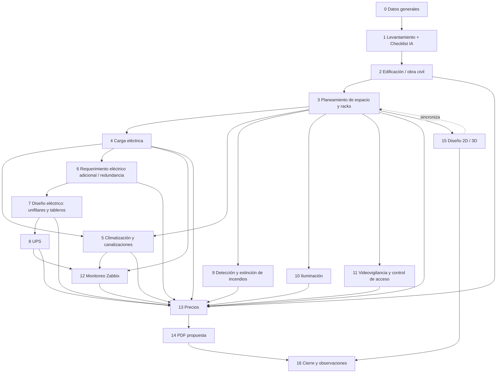

# 03 · Módulos del asistente (TIA-942)

> Base normativa: **ANSI/TIA-942-C (2024)** – niveles *Rated 1–4*, subsistemas: **Telecomunicaciones, Arquitectura, Eléctrico, Mecánico**. Complementos: ASHRAE TC 9.9 (clima), NFPA 75/76/2001 (incendio), NEC/normativa eléctrica local, BICSI 002.
> Los valores marcados *(param)* son de referencia y se configuran en `normative_parameters`; deben verificarse contra la copia licenciada de la norma.

## Convenciones comunes a todos los pasos
- **Estados**: `pendiente → en_progreso → observaciones → validado` · `bloqueado` (si hay error duro aguas arriba).
- **Supervisión**: cada paso tiene un *revisor* (rol) que valida; al cambiar un paso aguas arriba, los dependientes pasan a `requiere_revision`.
- **Guardado parcial** en cualquier momento (crea versión borrador).
- **Pop-up en vivo** con el resultado del paso + impacto global (kW, BTU, m², costo).
- **Rated objetivo** (1–4) se elige en el Paso 0 y condiciona límites de todos los pasos.

## Mapa de dependencias

---

## Paso 0 · Datos generales del proyecto (inmutables)
**Entradas**: nombre del proyecto, cliente (nuevo/existente), fecha, preventa responsable, personas involucradas, encargado del cliente, dirección, teléfono, correo, **Rated objetivo**, campos extensibles (definidos en *Plantilla*).
**Salidas**: `client_code` (`CLI-0001`), `project_code` único (`DAE-CLI0001-2026-0001`), versión `v1`.
**Reglas**: tras confirmar, estos campos quedan **bloqueados** (trigger en BD + guard en API). Cambios solo vía "Copiar proyecto".

## Paso 1 · Levantamiento físico
1. **Requerimiento escrito del cliente** (texto enriquecido + adjuntos).
2. **Registro fotográfico** (fotos geolocalizadas/etiquetadas por área: sala, acometida, tableros, techo, piso).
3. **Propuesta basada en el requerimiento** → **Pre-checklist generado por IA**:
   - Parte de la *Plantilla Datacenter* (pestaña editable) organizada por subsistemas TIA-942.
   - La IA autocompleta cada ítem con base en el requerimiento y datos primarios, y **explica cada respuesta** (`ai_explanation`, referencia normativa, nivel de confianza).
   - El ingeniero **aprueba / corrige** ítem por ítem (human-in-the-loop). Sin aprobación no se avanza.

## Paso 2 · Edificación / obra civil
**Dimensiones**: largo, ancho, altura libre (piso–losa), altura útil, carga del piso (kPa).
**Áreas definidas (espacios TIA-942)**: Entrance Room, MDA, HDA, ZDA, EDA (sala de cómputo), cuarto eléctrico/UPS, cuarto de baterías, cuarto de aires, NOC/monitoreo, áreas de soporte. Cada área tiene **dimensión mínima** *(param)*.
**Checklist de obra** (cada ítem: aplica / no aplica / estado / observación / foto):
- Piso técnico elevado: altura *(param: si altura libre > 3 m → 30 cm)*, baldosa 0,60 × 0,60 m, tipo de pedestal y anclaje, malla de tierra (SRG) bajo piso.
- Impermeabilización y pintura antiestática de piso y paredes.
- Bandejas de condensado bajo equipos de aire y revisión de desagües.
- Tapado de ventanas, retiro de mampostería, resane de fisuras, reacondicionamiento de paredes, repavimentado/resane de pisos.
- Revisión de techo, fugas de agua, planimetría y ubicación.
- Trabajos externos (subsuelo: bombas de achique, ductos de desagüe).
- Reforzamiento de paredes, vigas primarias/secundarias; levantamiento de suelo agrietado.
- **Validación obligatoria por rol Arquitecto** para ítems estructurales.
- Accesos: puerta mínima *(param: 1,0 m × 2,13 m)*, rampa de acceso, ruta de ingreso de equipos.

## Paso 3 · Planeamiento del espacio
- Ubicación de racks en grilla 0,60 m, filas, pasillo frío/caliente, distancias mínimas *(param: frente 1,2 m, posterior 1,0 m)*.
- Cantidad de equipos, rampa de acceso, cuartos (aires, UPS, baterías, NOC, sala).
- Requerimientos de redundancia por equipo (N, N+1, 2N).
- **Inventario por rack**: catálogo de equipos (U, W nominal, W típico, fuentes, conectores, peso). Racks 42U con previsión a **45U**.
- **Escenarios de crecimiento**: base, **+25 %**, **+50 %** → U, kW/rack, BTU/h, regletas, PDUs requeridas, m².

## Paso 4 · Análisis de carga eléctrica
Carga IT por rack y total, factor de simultaneidad, factor de potencia, cargas no-IT (clima, iluminación, seguridad), PUE estimado, escenarios 25/50 %. Desglose de parámetros técnicos requeridos.

## Paso 5 · Climatización y canalizaciones
- Carga térmica (IT + UPS + iluminación + personas + envolvente) por escenario; ¿el equipo base cumple a corto/largo plazo?
- Tipo (CRAC/CRAH, in-row, precisión), redundancia, ubicación de equipos, contención de pasillo frío o caliente, clusters requeridos.
- **Canalización**: eléctrica bajo piso técnico; datos y fibra **sobre racks** si la altura lo permite. Pila de alturas (ver doc 04 §4): piso técnico + rack 45U + 40 cm + bandeja cobre 15 cm + 15 cm + bandeja fibra 15 cm + 40 cm para luminarias.

## Paso 6 · Requerimiento eléctrico adicional y redundancia
- Por rack: **2 tomas 110 V + 1 toma 220 V** *(param)*, alimentación **A/B**: línea A a PDU-A, línea B a PDU-B; equipos con doble fuente toman energía del lado B si cae A.
- Tomas de servicio, redundancia eléctrica de equipos de aire.
- Cálculo de calibre de conductor por fase y circuito.

## Paso 7 · Diseño eléctrico
Levantamiento de acometidas eléctricas y de tierra, distancia a tablero principal, **diagramas unifilares**, tablero general → secundarios → tablero de UPS → tablero de salida de UPS → circuitos a PDUs, ubicación de PDUs y tomas, cálculo de carga por línea, balance de fases, sistema de puesta a tierra (TGB/TMGB).

## Paso 8 · UPS
Topología (**online doble conversión** recomendada), marca/modelo de catálogo, kVA/kW, carga total y con 25/50 %, autonomía de baterías, redundancia (N+1/2N), bypass de mantenimiento.

## Paso 9 · Detección y extinción de incendios
Tecnología de detección (VESDA/aspiración, fotoeléctricos), agente (Novec 1230, FM-200, Inergen), volumen protegido (sala + bajo piso + sobre techo), cálculo de agente, tubería y boquillas, estaciones manuales, sirenas, diagrama de ubicación de detectores (techo, bajo piso), áreas desalojables, tiempo de retardo.

## Paso 10 · Iluminación
Nivel *(param: 500 lux horizontal, 200 lux vertical)*, luminarias sobre pasillos (no sobre racks), iluminación de emergencia, cálculo de cantidad y circuito.

## Paso 11 · Videovigilancia y control de acceso
Cámaras (cobertura de accesos y pasillos), NVR, retención, control de acceso biométrico/tarjeta, diseño del área/sala de monitoreo (NOC).

## Paso 12 · Monitoreo (Zabbix)
Sensores: temperatura/humedad por rack (frente/arriba), humo, fuga de agua, puertas, corriente por PDU (PDUs monitoreables), UPS (SNMP), aires (Modbus/SNMP). Genera inventario de hosts, templates y umbrales para Zabbix (exportable XML/JSON).

## Paso 13 · Precios
Catálogo de precios versionado, BOM automático de todos los pasos, mano de obra, márgenes, moneda, impuestos, opciones base/25/50 %.

## Paso 14 · PDF de la propuesta
Plantilla HTML corporativa → PDF: portada, resumen ejecutivo, cumplimiento TIA-942, cálculos, planos 2D, renders 3D, BOM y precios, anexos fotográficos.

## Paso 15 · Diseño 2D y 3D
Editor 2D (fuente de verdad del layout) → vista 3D generada automáticamente. Todo cambio en 2D (agregar/mover rack, aire, PDU) **recalcula** energía, BTU, espacio y re-evalúa límites; se refleja en 3D en tiempo real.

## Paso 16 · Cierre
Guardado final, observaciones, aprobaciones, congelamiento de versión "Emitida".

## Pantalla de historial
Línea de tiempo de creación (versiones, autores, pasos) + **gráfico de línea** de cumplimiento por paso (score 0–100 %) en la parte superior, con marcadores en pasos mal desarrollados según reglas TIA-942. Desde aquí se pueden abrir y modificar pasos (genera nueva versión).
