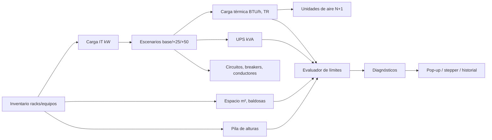

# 04 · Motor de cálculo y sistema de límites

## 1. Método propuesto: grafo reactivo de dependencias (DAG)

Cada dato del proyecto es un **nodo**. Cada cálculo es una **función pura** que declara sus entradas. Un cambio invalida solo los nodos dependientes, los recalcula y re-evalúa los límites.



Ejemplo: **agregar un rack** → ↑ kW → ↑ BTU → ↑ unidades de aire → ↑ kVA UPS → ↑ m² → el evaluador avisa si se excede el aire instalado, la capacidad del UPS o el área disponible.

### Implementación
- `packages/calc-engine/nodes/*.ts`: un archivo por nodo (`it-load.node.ts`, `thermal.node.ts`…).
- `engine.ts`: ordena topológicamente, memoiza, recalcula solo lo sucio.
- Corre en **Web Worker** (vista en vivo) y en **API** (validación autoritativa al guardar).

```ts
interface CalcNode<I, O> {
  id: NodeId;
  inputs: NodeId[];
  compute(input: I, params: NormativeParams): O;   // puro
}
interface LimitRule {
  id: string;                  // 'COOL-001'
  severity: 'info' | 'warning' | 'error' | 'blocking';
  ref: string;                 // 'TIA-942-C Mecánico' / 'ASHRAE A1'
  check(ctx: ComputedContext, params: NormativeParams): Diagnostic | null;
}
```

## 2. Severidad de límites
| Nivel | Efecto |
|---|---|
| `info` | Sugerencia |
| `warning` | Se acerca al límite (≥ 80 % de capacidad) – permite avanzar |
| `error` | Excede límite – permite guardar, no permite validar el paso |
| `blocking` | Incumple mínimo obligatorio del Rated – bloquea pasos dependientes |

Cada diagnóstico alimenta el **score de cumplimiento** del paso (historial).

## 3. Fórmulas base (parámetros configurables)
| Cálculo | Fórmula |
|---|---|
| Carga IT rack | `P_rack = Σ(W_equipo × f_simultaneidad)` |
| Escenarios | `P_25 = P × 1,25` · `P_50 = P × 1,50` |
| Carga térmica | `BTU/h = W × 3,412` · `TR = BTU/h ÷ 12 000` (+ UPS pérdidas, iluminación, personas ≈ 400 BTU/h c/u, envolvente) |
| Unidades de aire | `n = ceil(Q_total / Q_unidad) + redundancia (N+1 / 2N)` |
| UPS | `kVA = P_total ÷ FP ÷ utilización_máx (0,8)` |
| Corriente monofásica | `I = P ÷ (V × FP)` |
| Corriente trifásica | `I = P ÷ (√3 × V × FP)` |
| Protección | `I_breaker ≥ 1,25 × I` → calibre por tabla de ampacidad + caída de tensión (≤ 3 % circuito, ≤ 5 % total) |
| Autonomía | `t = (E_baterías × η) ÷ P_carga` |
| Espacio | huella rack (0,6 × 1,0/1,2 m) + pasillos mínimos, en múltiplos de baldosa 0,6 m |
| Carga de piso | `kg/m² ≤ capacidad piso técnico y losa` |

## 4. Pila de alturas (regla de canalización)
```
H_requerida = h_piso_técnico + h_rack_45U + 0,40 (al tope del rack)
            + 0,15 (bandeja cobre) + 0,15 (separación) + 0,15 (bandeja fibra)
            + 0,40 (luminarias)
Ejemplo: 0,30 + 2,10 + 0,40 + 0,15 + 0,15 + 0,15 + 0,40 = 3,65 m
Si H_requerida > altura_libre → error: canalización bajo piso o reducir capas.
```

## 5. Ejemplos de reglas
| ID | Regla | Severidad |
|---|---|---|
| SPC-001 | Pasillo frontal < mínimo *(param)* | blocking |
| SPC-002 | Área de racks + pasillos > área de sala | error |
| HGT-001 | `H_requerida > altura_libre` | error |
| FLR-001 | Altura libre > 3 m y sin piso técnico de 30 cm | warning |
| PWR-001 | Carga +50 % > capacidad UPS | warning |
| PWR-002 | Rack sin alimentación A/B en Rated ≥ 3 | blocking |
| COOL-001 | BTU total > capacidad instalada sin redundancia | error |
| COOL-002 | Densidad rack > *(param kW)* sin contención | warning |
| UPS-001 | Utilización UPS > 80 % | warning |
| FIRE-001 | Sin detección bajo piso técnico | error |

## 6. Parámetros normativos
Tabla `normative_parameters` (clave, valor, unidad, rated, fuente, vigencia). Editables solo por rol Administrador normativo; cada proyecto **congela** el set de parámetros usado en su versión para reproducibilidad.
