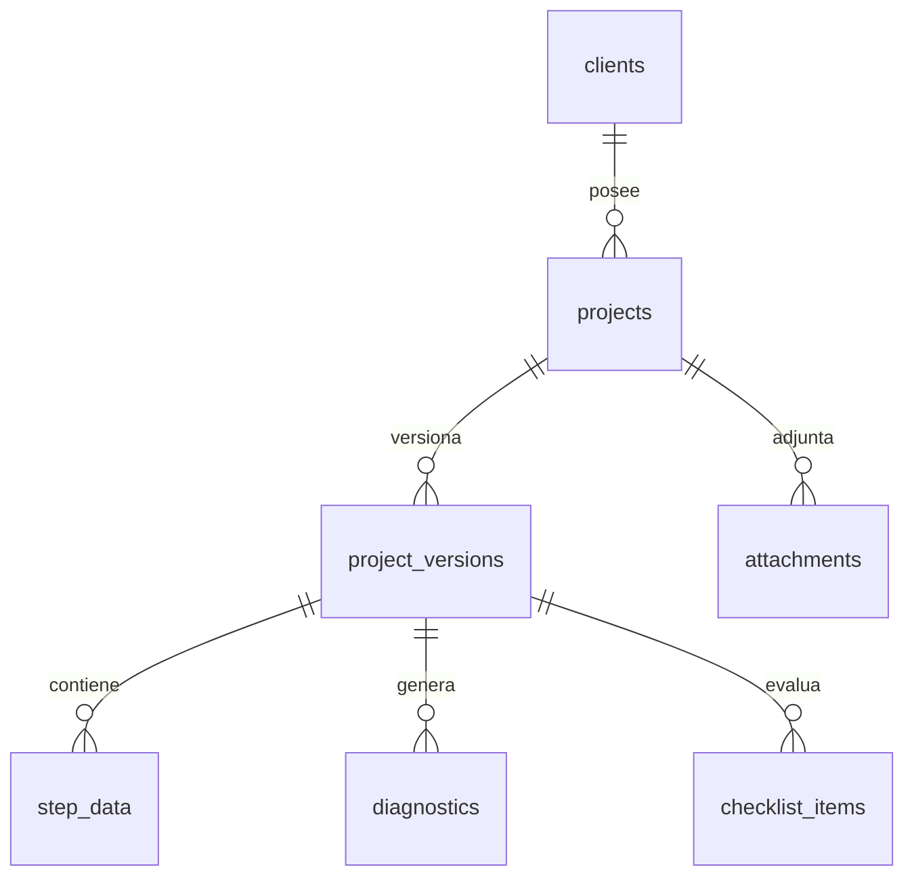

# 05 · Modelo de datos (PostgreSQL)

## 1. Seguridad y acceso (RBAC)
```mermaid
erDiagram
  users ||--o{ user_roles : tiene
  roles ||--o{ user_roles : asignado
  roles ||--o{ role_permissions : concede
  permissions ||--o{ role_permissions : incluido
  users { uuid id; text email; text password_hash; bool active; timestamptz last_login }
  roles { uuid id; text name; text description; bool system }
  permissions { uuid id; text code; text description }
```

**Permisos** formato `recurso:acción`:
`project:create|read|update|delete|copy|disable` · `step.<nn>:edit|validate` · `template:manage` · `checklist:approve` · `pricing:view|edit` · `user:manage` · `role:manage` · `normative:manage` · `report:generate`.

**Roles iniciales**: Administrador · Gerente/Preventa · Ingeniero de diseño · Arquitecto (valida obra civil) · Revisor TIA · Visualizador/Cliente.

## 2. Proyectos y versionado


| Tabla | Campos clave |
|---|---|
| `clients` | id, code `CLI-0001` (único), name, contact, address, phone |
| `projects` | id, code `DAE-CLI0001-2026-0001` (único), client_id, **general_data JSONB (inmutable)**, rated_target, status (`active`/`disabled`), deleted_at, created_by |
| `project_versions` | id, project_id, version_no, parent_version_id, label (`borrador`/`emitida`), normative_snapshot JSONB, note, created_by, created_at |
| `step_data` | version_id, step_key, data JSONB, status, reviewer_id, validated_at, compliance_score |
| `diagnostics` | version_id, step_key, rule_id, severity, message, ref |
| `attachments` | project_id, step_key, area, s3_key, tags, taken_at |
| `checklist_templates` / `checklist_template_items` | plantilla editable "Plantilla Datacenter" (subsistema, pregunta, tipo, ref TIA, rated) |
| `checklist_items` | version_id, template_item_id, value, ai_value, **ai_explanation**, ai_confidence, approved_by |
| `equipment_catalog` | tipo (servidor, switch, UPS, aire, PDU, rack), U, W, BTU, peso, precio |
| `price_lists` | versión de precios, moneda, vigencia |
| `normative_parameters` | key, value, unit, rated_level, source, valid_from |
| `audit_log` | user_id, entity, entity_id, action, diff JSONB, ts |

## 3. Reglas de integridad
- **Inmutabilidad Paso 0**: trigger `BEFORE UPDATE` en `projects` que rechaza cambios en `general_data`, `code`, `client_id`.
- **Versiones append-only**: sin `UPDATE`/`DELETE` sobre `project_versions` (solo inserción). Cada guardado = nueva versión con `parent_version_id` + diff JSON Patch en `audit_log`.
- **Copiar proyecto**: nuevo `project.code`, copia la última versión como `v1` con referencia de origen.
- **Deshabilitar**: `status = disabled` → solo lectura. **Eliminar**: `deleted_at` (lógico).
- Generación de códigos con secuencias por cliente y año (transacción `SERIALIZABLE`).
